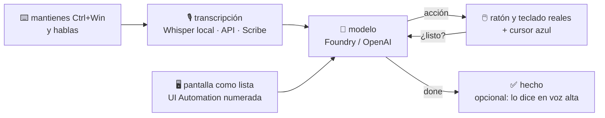

<div align="center">

# 🌊 Colo

**Le hablas a tu PC y lo hace.**

Mantienes `Ctrl+Win`, dices lo que quieres, sueltas.
Una onda blanca te escucha, un cursor azul se mueve solo y la tarea queda hecha.

[**⬇ Descargar Colo.exe**](https://github.com/Villamediana/Own-Computer-Use/releases/latest) &nbsp;·&nbsp; [Cómo funciona](#cómo-funciona) &nbsp;·&nbsp; [Compilar](#compilar)


</div>

---

> «abre Outlook y respóndele a Ana que el jueves me queda bien»
> «pásame este PDF a la carpeta de facturas»
> «sube el volumen y pon la playlist de ayer»

Colo es un agente de escritorio para Windows: ve la pantalla (los elementos de la interfaz, numerados), decide el siguiente paso y usa el ratón y el teclado de verdad — con un cursor azul que deja ver qué va a tocar antes de tocarlo.

Un solo `.exe`, trae .NET adentro, no instala nada ni pide permisos de administrador.

## Cómo funciona



- El micrófono **solo se abre mientras mantienes el atajo**. Nada queda escuchando.
- La pantalla viaja como **texto** (lista de elementos con estado: foco, marcado, desplegado…). La captura de imagen va solo cuando el modelo la pide.
- Cada acción se ejecuta **en cuanto el modelo la emite** (streaming). Una orden simple = una sola llamada.
- Si hablas en medio de una tarea, el paso actual se corta y Colo lee lo nuevo. «Para» o «déjalo» lo detiene sin tocar nada más.

## Lo que sabe hacer

| | |
|---|---|
| 🖱️ **Ratón y teclado** | clic, arrastrar, scroll, escribir, corregir un trozo de texto sin reescribirlo, atajos |
| 🌐 **Navegador** | ir a una página, pestañas, buscar, encontrar en la página |
| 🪟 **Ventanas** | abrir programas, enfocar, minimizar, cerrar — y te avisa si hay dos parecidos (Outlook clásico / nuevo) |
| 📖 **Leer** | texto de la ventana, del campo con foco, la selección, el portapapeles |
| 📂 **Archivos** | buscar y mover archivos |
| ✍️ **Dictar** | atajo aparte: transcribe, corrige con tu tono y escribe donde está el cursor |
| 🧠 **Memoria** | recuerda cómo llamas a tus cosas y qué apps usas (lo ves y lo borras en Ajustes) |
| 🔐 **Cofre** | contraseñas cifradas con DPAPI; el modelo solo ve los nombres, nunca el secreto |
| 🔌 **MCP** | conecta servidores MCP (stdio o HTTP) y elige qué tools usa |
| 🗣️ **GPT-Live** | opcional: conversación en vivo por voz; Colo hace lo que haya que hacer en el PC |

## Uso

| Atajo | Qué hace |
|---|---|
| mantener `Ctrl+Win` | hablarle (se cambia en Ajustes › Voz) |
| `Ctrl+Alt+Espacio` | pausar / seguir |
| `Ctrl+Alt+X` | detener la tarea |
| clic en la onda | pausar / seguir · arrastrar = mover · clic derecho = menú y Ajustes |

**Ajustes** es una página dentro de la app que se guarda sola. Ahí eliges el modelo (Azure AI Foundry u OpenAI), cómo transcribir (Whisper en el propio PC, sin tokens; el modelo de transcripción de la API; o ElevenLabs Scribe), la voz de las respuestas y qué grupos de herramientas usar.
**Costo** muestra lo que va gastando cada modelo, hoy y en total.

Tus llaves quedan en `%APPDATA%\Colo\settings.json`, cifradas con DPAPI: solo tu usuario, en ese PC, las abre.

<details>
<summary><b>Los detalles que lo hacen sentir rápido</b></summary>

<br>

- **Movimiento**: el ratón real y el cursor azul se deslizan juntos al ritmo del monitor (DwmFlush), con curva de jerk mínimo y un arco leve. Todo entra con muelle: la flecha rebota, la etiqueta se estira al texto nuevo, el clic suelta ondas y chispas.
- **Atajos que se mantienen**: cualquier par de teclas, incluso dos letras cercanas; si no llega la segunda, la primera se reenvía tal cual. Con una tercera tecla encima (Ctrl+Win+D) es otro atajo y no transcribe.
- **Contexto corto**: recuerda los últimos pedidos y lo que hizo en cada uno («ahí no, en la barra») y se olvida solo tras 10 minutos.
- **Plan**: un pedido con varias partes empieza con un plan corto que se sigue en orden (✓ hecho, → ahora). Tope de 40 pasos por orden.
- **Caché**: instrucciones y tools van primero e iguales en cada paso, la pantalla al final; con `prompt_cache_key` fijo el proveedor reutiliza el prefijo.
- **Registro**: `%LOCALAPPDATA%\Colo\colo.log` (micrófono, frases, órdenes, errores).

</details>

## Compilar

Funciona desde Windows o Linux.

```bash
dotnet test tests/Colo.Tests
dotnet publish src/Colo -c Release -o dist      # dist/Colo.exe — un solo archivo
```

```
src/Colo.Core   el cerebro: agente, cliente del modelo, tools, memoria, voz, MCP (sin nada de Windows)
src/Colo        la parte Windows: onda, cursor, UI Automation, atajos, ajustes (WebView2)
tests/          unitarios, UI de ajustes (playwright-core) y e2e
tools/Preview   renderiza la onda y el cursor a PNG y corre el bucle real contra un endpoint (también en Wine)
installer/      instaladores Inno Setup y NSIS
```

---

<div align="center">
<sub>Hecho por <a href="https://github.com/Villamediana">Miguel Villamediana</a> · Windows, por ahora 🌊</sub>
</div>
